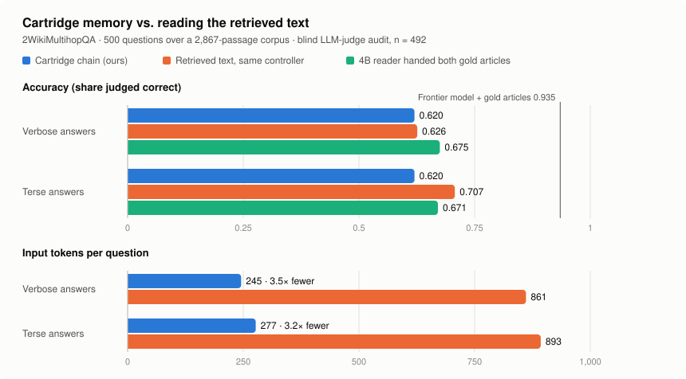
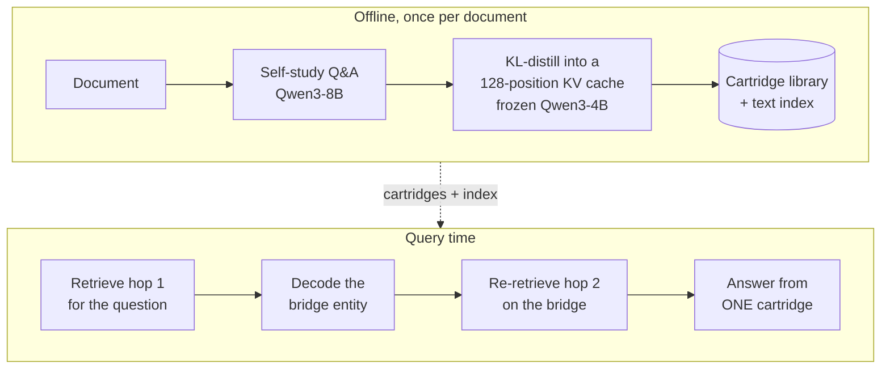

# Cartridge Libraries

**Compressed, continually-extensible KV-cache memory for multi-hop question answering on a frozen LLM.**

A *cartridge* is a small trained key-value cache that stands in for a document: distill it once, then
load it instead of re-reading the text. This project builds a **library** of per-document cartridges on a
frozen Qwen3-4B and answers multi-hop questions by reading **one cartridge per hop**. On 500
2WikiMultihopQA questions over a 2,867-passage corpus, under a blind LLM-judge audit, the compressed
memory is **statistically indistinguishable from reading the retrieved text** under an identical
controller, while feeding the model **3.5× fewer input tokens per question**.

Hannah Wu · University of Pennsylvania · research project, paper in preparation

<picture>
  <source media="(prefers-color-scheme: dark)" srcset="assets/results-dark.svg">
  
</picture>

| | verbose answers | terse answers | input tokens / question |
|---|---|---|---|
| **Cartridge chain (ours)** | **0.620** | **0.620** | **245** |
| Retrieved text, same controller | 0.626 | 0.707 | 861 |
| 4B reader handed both gold articles | 0.675 | 0.671 | — |
| Frontier model + both gold articles | 0.935 | — | — |

*Share of questions a blind LLM judge marks correct (n = 492 after removing 8 defective gold answers).
Cartridge vs text under verbose answers: paired McNemar p = 0.83. "Same controller" means identical
retrieval and multi-hop logic; only the memory read differs.*

---

## How it works



Retrieval runs on frozen *text* embeddings, deliberately decoupled from the KV caches, so adding a
document means training one cartridge in isolation and appending one index row. Nothing else changes.

## Key findings

1. **Composing cartridges fails by blending, so the system routes instead.** A custom order-invariant
   composition operator lifts real-content composition from 0.47 to 0.65 over concatenation, but an
   attention probe shows co-relevant cartridges split weight about 50/50 regardless of which one holds
   the answer. A cartridge that answers alone at 1.00 falls to 0.67 / 0.58 / 0.47 when 1–3 related
   cartridges are composed onto it. No gate can repair an averaging loss, so the deployed system reads
   one cartridge per hop.
2. **The compressed memory matches retrieved text at a fraction of the input.** 0.620 vs 0.626
   (p = 0.83) at **8.8× fewer input tokens per hop**. A controlled re-run with the corpus grown to
   6,175 passages, same questions and same cartridges, leaves the gap unchanged (p = 0.51).
3. **Decomposition is what multi-hop needs.** The chain leads single-shot dense retrieval by 34 points
   of contains-EM (p ≈ 1e-32), unchanged at 2.15× the corpus. On controlled depth-2/3/4 chains,
   end-to-end accuracy equals the product of per-hop success, and the cartridge chain equals the text
   chain at every depth.
4. **Train on the format you serve.** Cartridges distilled on full-sentence self-study degraded under
   short-answer prompts. Re-distilling the 375 answering cartridges on short-answer self-study added 22
   correct answers (p = 0.002) with no cost to verbose answers. The remaining terse gap to text comes from
   how each substrate converts refusals into answers when forced to commit, not from compression; a
   coverage-matched control rules out missing cartridges as the cause.
5. **A library that grows without forgetting.** With a frozen model and isolated cartridges,
   weight-level forgetting is impossible by construction. Growing the library from 49 to 196 cartridges
   under random and adversarial arrival orders changed old-question accuracy by **0.000**; 60 unseen
   documents arrive at full quality (0.833) for a constant 281 s each. Knowledge updates work by
   re-distilling from scratch (0.70) where warm-start editing fails outright (0.00).

## Evaluation methodology

- **Every headline number is blind-audited.** An LLM judge sees only the question, gold answer and
  prediction, never which system produced it, and every comparison is a paired McNemar test. Lexical
  metrics had reversed two raw headline comparisons, because contains-style metrics credit refusals
  that happen to quote the gold answer. Strict exact match understates absolute accuracy on this
  benchmark by about 0.27, uniformly across systems.
- **Benchmark sanity checks.** On HippoRAG 2's released 1,000-question 2Wiki sample, the same 4B reader
  with **no context** scores 0.229 exact match, against 0.022 on this project's sample. Nearly half of
  the standard sample is comparison questions that name both candidates, where retrieval adds nothing.
  This project's filter selects the retrieval-bearing subset, which is why its numbers are not directly
  comparable to pooled published scores.

## Engineering highlights

- **Context distillation from scratch.** Each cartridge is a key and value tensor of shape
  36 layers × 8 KV heads × 128 positions × 128 dims, 9.4M trainable parameters (0.2% of the base model),
  injected through a custom `DynamicCache` with RoPE-offset positions and trained with answer-token KL.
- **Patched attention.** The composition operator attends each cartridge at its own trained positions
  and merges by per-cartridge log-sum-exp, making composition exactly order-invariant.
- **Scale.** 927 cartridges from 1.85M generated conversations, sharded into 60 disjoint units across an
  on-prem 2×RTX 4090 server and a rented RTX 5090 (about 466 GPU-hours), resumable per document. 8-bit
  Adam fits a 196-cartridge pool (1.85B trainable parameters) beside the frozen model on one 24 GB GPU.
- **Throughput.** Profiling showed 87% of generation time was sequential question generation; batching
  question rounds delivered a 1.77× speedup.
- **Agent integration.** The controller runs as a LangGraph `StateGraph` with a swappable memory read,
  prediction-for-prediction identical to the reference (500/500). An 8B ReAct agent with worked examples
  matches it with the hop count hidden, but at 37× the tokens.

## Where to start

| file | what it is |
|---|---|
| [`scripts/cartridge_qwen.py`](scripts/cartridge_qwen.py) | Core library: model loading, the cartridge module, distillation loop, KV-cache injection, patched attention |
| [`scripts/cartridge_runtime.py`](scripts/cartridge_runtime.py) | Serving runtime and the multi-hop chain controller |
| [`scripts/generate_selfstudy_data.py`](scripts/generate_selfstudy_data.py) | Synthetic self-study generator (batched, resumable, grounded) |
| [`scripts/train_joint.py`](scripts/train_joint.py) | Cartridge trainer: isolated (deployed) or mixed-visibility joint training |
| [`scripts/router.py`](scripts/router.py) | The deployed system: retrieve, route or chain, answer |
| [`scripts/text_rag.py`](scripts/text_rag.py) | Text baselines over the identical index: single-shot RAG, IRCoT, gold-text oracle |
| [`scripts/claude_oracle.py`](scripts/claude_oracle.py) | Blind LLM-judge audit and frontier-model oracle |
| [`scripts/run_campaign_machine.sh`](scripts/run_campaign_machine.sh) | The sharded, resumable 927-cartridge training campaign |

<details>
<summary>All scripts, by role</summary>

- **Data:** `fetch_2wiki_dev.py`, `prepare_2wiki.py`, `convert_hipporag_data.py`, `prepare_squad.py`,
  `build_article_corpora.py`, `build_synth_*.py`, `rewrite_decoys_matched.py`,
  `build_unseen_arrivals.py`, `build_versioned_updates.py`, `synth_rosters.py`
- **Self-study:** `generate_selfstudy_data.py`, `generate_relational_selfstudy.py`,
  `generate_bridge_data.py`, `mix_*.py`, `subsample_selfstudy.py`, `filter_relational_selfstudy.py`,
  `carve_corpus_slice.py`, plus quality gates `check_selfstudy_quality.py`, `check_coverage.py`,
  `claude_datacheck.py`
- **Training:** `train_joint.py`, `train_squad_cartridges.py`, `train_gate.py`
- **Retrieval and serving:** `build_cartridge_index.py`, `build_topic_layer.py`, `router.py`,
  `cartridge_runtime.py`, `text_rag.py`, `langgraph_chain.py`, `langgraph_agent.py`, `benchmark_cost.py`
- **Evaluation:** `claude_oracle.py`, `evaluate_composition.py`, `eval_fidelity.py`, `eval_nhop.py`,
  `eval_style_lock.py`, `eval_generality.py`, `eval_versioning.py`, `continual_add.py`,
  `evaluate_squad.py` (shared metrics)
- **Analysis:** `analyze_chain_failures.py`, `analyze_router_split.py`, `probe_weights.py`,
  `resolution_gap_test.py`, `classify_compose_failures.py`, `oracle_patterns.py`, `summarize_*.py`,
  `make_readme_figure.py`, `make_poster_figures.py`
- **Tests:** `test_cartridge_roundtrip.py` (save → load → decode is bit-exact, including composed cartridges)
- **Experiment drivers:** `run_campaign_machine.sh`, `run_terse_redistill.sh`, `run_stylelock150.sh`,
  `run_distractor_carts.sh`, `run_bigcorpus.sh`, `campaign_status.py`

</details>

## Reproduce

Needs one or more 24 GB GPUs. The audit and oracle steps also need `ANTHROPIC_API_KEY`.

```bash
pip install -r requirements.txt

# 1. Benchmark: 500 2Wiki questions, their gold articles, and the full candidate corpus
python scripts/fetch_2wiki_dev.py
python scripts/prepare_2wiki.py --dev-json data/2wiki_raw/dev.jsonl --out-dir data/2wiki_scale \
    --types compositional,inference --min-tokens 128 --max-questions 500

# 2. Generate self-study data and train every cartridge (one shard = the whole set; split across
#    machines with e.g. 1/60 ... 60/60 — each shard resumes independently)
bash scripts/run_campaign_machine.sh all 1/1

# 3. Index the full corpus and run the system, both answer styles
python scripts/build_cartridge_index.py --articles-file data/2wiki_scale/corpus.jsonl \
    --cartridge-dir cartridges/2wiki_scale --cartridge-len 128 --embed-only \
    --embedder BAAI/bge-large-en-v1.5 \
    --query-instruction "Represent this sentence for searching relevant passages: " \
    --out-file cartridges/2wiki_scale/index_full.json
python scripts/router.py --index cartridges/2wiki_scale/index_full.json \
    --multihop-file data/2wiki_scale/multihop.jsonl --articles-file data/2wiki_scale/corpus.jsonl \
    --cartridge-len 128 --modes dense,chain --top-k 1 --chain-template --chain-overhop-guard \
    --results-dir results/chain_verbose        # add --short-answer for terse answers

# 4. Text baselines over the identical index
python scripts/text_rag.py --index cartridges/2wiki_scale/index_full.json \
    --multihop-file data/2wiki_scale/multihop.jsonl --articles-file data/2wiki_scale/corpus.jsonl \
    --modes dense,chain,oracle,noctx --top-k 1,2,3 --results-dir results/text_verbose
```

`data/` ships the synthetic mechanism testbeds (fictional entities, so no model can answer from
memory). 2WikiMultihopQA is regenerated by the commands above rather than redistributed.

## Status

Paper in preparation. Numbers are from the 500-question scaled benchmark and may change in the final
version. This repository is a curated snapshot of the research codebase; superseded experiment drivers
and working notes are not included.

<!-- Acknowledgements: add advisor / lab here before making the repository public. -->
